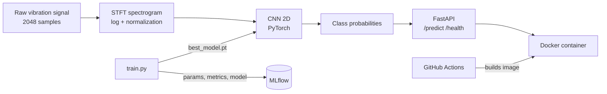

# ⚙️ Bearing Fault Diagnosis & MLOps Pipeline


An end-to-end predictive maintenance project: a PyTorch CNN that diagnoses the condition of a rolling bearing from its raw vibration signal, tracked with MLflow, served through a FastAPI REST API, packaged with Docker and built automatically by GitHub Actions.

---

## 🎯 Problem

Bearing failures are among the most common causes of breakdown in electric motors and rotating machines. The model classifies a bearing into four states:

| Class | Meaning |
|---|---|
| `normal` | healthy bearing |
| `ball` | fault on a rolling element |
| `inner_race` | fault on the inner ring |
| `outer_race` | fault on the outer ring |

---

## 🛠️ Tech Stack & Architecture

- **Signal Processing:** raw vibration data split into windows of 2048 samples (50% overlap) and converted into log-scaled spectrograms with the Short-Time Fourier Transform (STFT).
- **Deep Learning:** custom 2D Convolutional Neural Network (`BearingCNN`) built with **PyTorch** for multi-class classification.
- **Experiment Tracking:** **MLflow** logs hyperparameters, per-epoch metrics and the versioned model.
- **API & Backend:** web service powered by **FastAPI** and **Uvicorn**, with input validation through **Pydantic**.
- **Containerization:** **Docker** image (Python 3.12, CPU build of PyTorch) for reproducibility on any machine.
- **CI:** **GitHub Actions** builds the Docker image on every push to `main`.



---

## 📊 Data & Pipeline

**Dataset:** [CWRU Bearing Data Center](https://engineering.case.edu/bearingdatacenter/download-data-file), 12 kHz drive-end recordings, one file per condition, single motor load. The `.mat` files are not stored in this repository; place them in `data/` as `Normal_0.mat`, `Ball.mat`, `Inner_race.mat` and `Outer_race.mat`.

1. **Split before windowing:** the last 20% of each raw signal is reserved for validation *before* segmentation. Splitting after windowing would leak data, since overlapping windows share half of their samples.
2. **Spectrograms:** STFT (`nperseg=128`, `noverlap=64`) with log compression, giving 65 x 31 images (470 training windows, 112 validation windows).
3. **Normalization:** mean and standard deviation computed on the training set only, saved in `data/norm_stats.json` so the API applies the exact same transformation.
4. **Model:** two convolution blocks (BatchNorm, ReLU, MaxPool), adaptive average pooling, a 64-unit dense layer with Dropout, 4 outputs. Trained with Adam (lr 1e-3, batch size 16, 20 epochs).

---

## ✅ Results

100% accuracy on the validation set.


> **Read with care:** CWRU at a fixed motor load is a well-known easy benchmark, and the validation windows come from a later segment of the same recordings. The score shows that the pipeline works end to end, not that the model would generalize to other machines or operating conditions.

---

## 🔌 API

| Endpoint | Method | Description |
|---|---|---|
| `/health` | GET | service status, model loaded, list of classes |
| `/predict` | POST | diagnosis from a raw signal of exactly 2048 values |
| `/docs` | GET | interactive documentation generated by FastAPI |

Any request that does not contain exactly 2048 numbers is rejected with an HTTP 422 error. The model is loaded once at startup.

```python
import requests

signal = [...]  # 2048 floats
r = requests.post("http://127.0.0.1:8000/predict", json={"signal": signal})
print(r.json())
```

```json
{
  "prediction": "ball",
  "confidence": 0.9619,
  "probabilities": {
    "ball": 0.9619,
    "inner_race": 0.012,
    "normal": 0.0125,
    "outer_race": 0.0135
  }
}
```

---

## 🐳 Run with Docker

```bash
docker build -t bearing-api .
docker run -p 8000:8000 bearing-api
```

Then open `http://127.0.0.1:8000/docs`.

## 💻 Run locally

```bash
pip install torch numpy scipy scikit-learn matplotlib mlflow fastapi uvicorn requests

python build_dataset.py     # spectrogram dataset (needs the .mat files in data/)
python train.py             # trains the CNN and logs the run to MLflow
python evaluate.py          # confusion matrix and per-class metrics
python show_runs.py         # prints the MLflow runs in the terminal
python -m uvicorn api:app   # serves the API on http://127.0.0.1:8000
python test_api.py          # sends one validation window per class to the API
```

---

## 📂 Project Structure

```text
bearing-fault-diagnosis/
│
├── api.py                  # FastAPI application (/predict, /health)
├── model.py                # PyTorch model definition (BearingCNN)
├── dataset.py              # PyTorch Dataset
├── build_dataset.py        # windowing, spectrograms, split, normalization
├── train.py                # training loop + MLflow tracking
├── evaluate.py             # confusion matrix, classification report
├── explore_signal.py       # signal visualization
├── explore_spectrogram.py  # spectrogram visualization
├── show_runs.py            # reads MLflow runs from the terminal
├── test_api.py             # sends real signals to the running API
├── checkpoints/
│   └── best_model.pt       # trained model weights
├── data/
│   └── norm_stats.json     # normalization statistics used by the API
├── docs/
│   └── confusion_matrix.png
├── Dockerfile              # Docker configuration
├── requirements-api.txt    # dependencies of the API image
├── .dockerignore           # optimized build context
├── .github/workflows/ci.yml
└── README.md
```

---

## 🚧 Limitations & Next Steps

- **Single operating condition:** all recordings share the same motor load. The key next experiment is training on one load and testing on another.
- **Automated tests:** the API is tested manually with `test_api.py`; unit tests would be added to the CI.
- **Monitoring:** latency, error rate and prediction distribution (Prometheus and Grafana) are not implemented yet.
- **Alternative architectures:** a 1D CNN on the raw signal (such as WDCNN) as a comparison with the spectrogram approach.